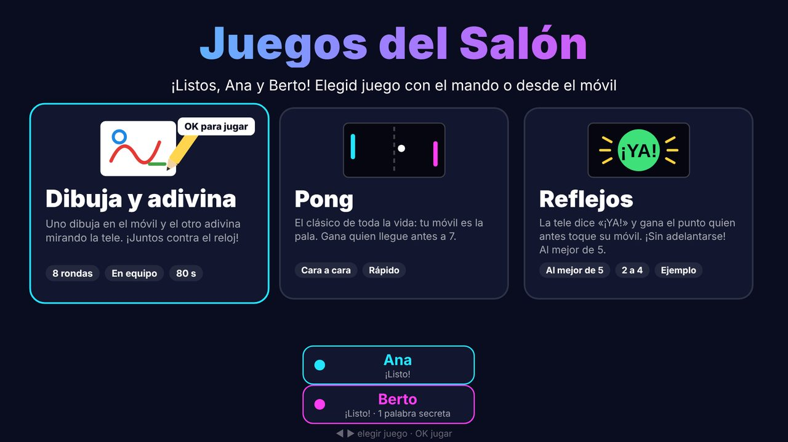
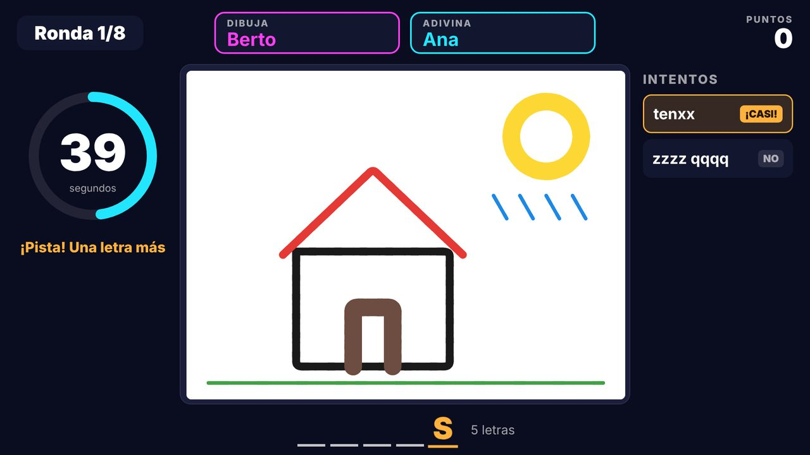
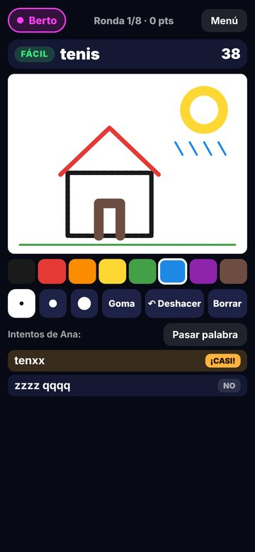
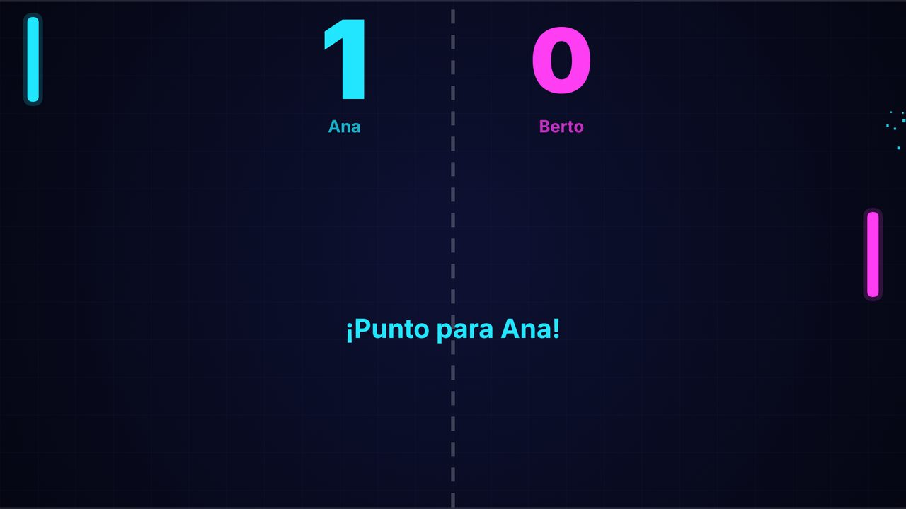

# game-to-tv · Juegos del Salón

**Juegos de grupo para el salón (de 2 a 6 jugadores, y «2048» también a solas): la tele es la pantalla y
los móviles son los mandos.** Se escanea un QR y a jugar: no hay que instalar nada en los móviles.
Un pequeño servidor de Node.js reparte el juego. En una **tele LG o Android
(Android TV, Google TV, Fire TV) va dentro de la propia tele** (el PC solo hace
falta para instalar la app); con cualquier otra pantalla, corre en un PC de casa. Unos *drivers* se encargan de poner los
juegos en la tele (instalar una app, abrirla, mandar avisos, hacer capturas…).



<p>
  
  
</p>



```
  LG webOS (modo tele, sin PC):
  Móvil 1 ──┐            ┌──────────── Tele LG ────────────┐
     …      ├── Wi‑Fi ──▶│ app «Juegos del Salón»          │
  Móvil 6 ──┘            │ + servidor dentro (puerto 8090) │
                         └─────────────────────────────────┘
  QR en la tele → http://IP-DE-LA-TELE:8090/m

  Cualquier pantalla con navegador (modo pc):
  Móvil 1 ──┐                          ┌── Tele (navegador o app lanzadora)
     …      ├── Wi‑Fi ── PC con Node ──┤   http://IP-DEL-PC:3000/
  Móvil 6 ──┘   (game-to-tv start)     └── QR → http://IP-DEL-PC:3000/m
```

## Juegos incluidos

| Juego | Jugadores | De qué va |
|---|---|---|
| **Dibuja y adivina** | 2 a 6 | Pictionary: uno dibuja en el móvil y los demás adivinan mirando la tele. Con 2, en equipo (8 rondas y un título final). De 3 a 6, todos contra todos: el dibujante rota, todos adivinan a la vez y quien antes acierta, más puntos; clasificación con medallas. Pistas, palabras secretas para los demás y galería de dibujos en PNG. |
| **El Infiltrado** | 3 a 6 | Deducción: todos ven en el móvil el lugar secreto y su papel… menos el infiltrado. Por turnos os hacéis preguntas en voz alta (la tele dice a quién le toca); cada uno puede acusar una vez por ronda (hace falta que todos digan «Sí») y el infiltrado puede arriesgarse con «¡Sé el lugar!». Si se acaba el tiempo, votación final. Carta tapada en el móvil, 40 lugares más los vuestros, y clasificación. |
| **Pong** | 2 a 4 | El clásico, con el móvil como pala, a 60 FPS en la tele. Con 3 o 4, por parejas: dos palas por lado, como en el futbolín. |
| **2048** | 1 a 6 | Inspirado en el 2048 clásico: desliza las fichas y junta números iguales hasta llegar a 2048. A solas, un tablero grande en la tele, con «Récord» por nombre; se juega con el móvil (gestos o flechas grandes) o con las flechas del teclado o del mando. De 2 a 6, una carrera de 3 minutos con un tablero por jugador y clasificación con medallas. |
| **Reflejos** | 2 a 6 | El juego de ejemplo: la tele dice «¡YA!» y gana el punto quien antes toque su móvil. Al mejor de 5. |

### 1 contra 1

Duelos rápidos para dos, agrupados en la tarjeta «1 contra 1» del menú:

| Juego | De qué va |
|---|---|
| **Tanques** | Tanques en un pequeño laberinto; las balas rebotan en las paredes… y también te pueden dar a ti. Palanca y «¡Fuego!» en el móvil (en horizontal). A 5. |
| **Motos de neón** | Cada moto deja una estela: choca contra una pared o una estela y pierdes la ronda. Desliza el dedo o usa la cruceta. A 5. |
| **Sumo** | Dos bolas gorditas en un círculo que encoge: empuja, embiste con «¡Embestida!» y saca a tu rival. Al mejor de 5. |
| **Hockey de mesa** | Mueve la maza arrastrando el dedo por tu mitad de la mesa (móvil en horizontal) y mete el disco en la portería contraria. A 7. |

**Rivales bot:** ¿no hay con quién jugar? En el menú del móvil, «🤖 Añadir
rival» y elige su nivel (Fácil, Normal, Difícil o Imposible): entra en la sala
un jugador más, con nombre (Paco, Lola, Maripili…) y color, que juega solo. Hay
rivales en Tanques, Motos de neón, Sumo, Hockey de mesa, Pong, Reflejos y 2048;
Dibuja y adivina y El Infiltrado no los admiten y salen en gris mientras
haya bots («Este juego no admite rivales: quita los bots»). Se quitan con la ×
de la lista de jugadores y se van solos cuando no queda nadie.

**Solo con el móvil:** abre `http://IP:PUERTO/solo` y el móvil es a la vez
pantalla y mando (el juego detrás y los mandos medio transparentes delante).
Con un rival bot, cualquiera de esos juegos se puede jugar con un solo móvil.

El menú de la tele muestra para cuántos es cada juego y, si no encaja con los
que sois, lo pone en gris con el motivo («De 2 a 4 jugadores · sois 6»).

## Pantallas compatibles

| Pantalla | Estado | Cómo |
|---|---|---|
| LG webOS (probado en webOS 22) | ✅ sin PC (la tele es el servidor) | App instalada con el modo desarrollador; el servidor de los juegos va dentro de la tele. Desde el PC: instalar, abrir, estado, avisos, botones, capturas y medir FPS. También en modo pc (`--modo pc`). |
| Navegador (cualquier tele, proyector o portátil con navegador) | ✅ | Abrir la dirección que muestra `game-to-tv start`. Nada que instalar. |
| Android TV / Google TV / Fire TV | ✅ app con el servidor dentro | App «Juegos del Salón» (Android 7+, ARM de 32 o 64 bits) instalada con `adb` desde el PC; el servidor de los juegos va dentro de la tele (Node.js de nodejs-mobile, puerto 8090). Desde el PC: instalar, abrir, estado, información, botones, capturas y FPS. Guía: [docs/tele-android.md](docs/tele-android.md). |
| Samsung Tizen | 🔜 | Pendiente (ver [docs/roadmap.md](docs/roadmap.md)). |

## La forma más fácil (sin saber nada técnico)

Para jugar con un ordenador de casa (Windows 10/11 o Mac) y cualquier tele, sin
terminal, sin git y sin instalar Node.js a mano, hay un archivo de doble clic
en [instalar/](instalar/):

- **Windows**: [`Juegos-del-Salon-Windows.bat`](instalar/Juegos-del-Salon-Windows.bat)
- **Mac**: [`Juegos-del-Salon-Mac.command`](instalar/Juegos-del-Salon-Mac.command)

La primera vez descarga el Node.js oficial (versión fija, comprobada con su
SHA-256) y los juegos en una carpeta del usuario (`%LOCALAPPDATA%\game-to-tv`
o `~/Library/Application Support/game-to-tv`), **sin permisos de
administrador**; cada vez que se vuelve a abrir, actualiza los juegos (y si no
hay Internet, usa los que ya tenía). Después arranca el servidor, abre la
pantalla de la tele a pantalla completa en el navegador del ordenador (para
conectarlo a la tele por HDMI) y dice, en grande y en castellano llano, la
dirección para el navegador de la tele y que no hay que cerrar la ventana. En
Windows, además, crea el icono «Juegos del Salón» en el escritorio y, si la red
está como «Pública» o falta la regla del cortafuegos, pide permiso **una sola
vez** para abrir el puerto 3000 solo a la red de casa (y, si se acepta, marcar
la red como Privada).

Guía para la familia (qué pulsar en cada aviso, HDMI, el QR, qué hacer si un
móvil no conecta): **[docs/guia-familia.md](docs/guia-familia.md)**.

> **Para quien envía el archivo.** El `.bat` se puede mandar tal cual (por
> WhatsApp, como documento). El `.command` de Mac, mejor dentro de un zip
> (`zip Juegos-del-Salon-Mac.zip Juegos-del-Salon-Mac.command`): así conserva
> el permiso de ejecución; suelto, al descargarlo el Mac suele decir que no
> tiene permiso para abrirlo. Avisos que verán: SmartScreen («Windows protegió
> su PC»), el control de cuentas de usuario para el cortafuegos y, en Mac,
> Gatekeeper; la guía explica qué pulsar. Algunos antivirus desconfían de los
> `.bat` que descargan cosas con PowerShell: si lo bloquean, hay que
> permitirlo a mano.

## Inicio rápido

Necesitas un PC (Windows, macOS o Linux) con **Node.js 18 o superior** en la
misma red que la tele y los móviles. Con una tele LG, el PC solo se usa para
instalar la app ([más abajo](#lg-webos)); para cualquier otra pantalla:

```bash
npm install -g game-to-tv      # o, sin instalar: npx game-to-tv start
game-to-tv start
```

> Aún no está publicado en npm. Mientras tanto, desde el código:
> `git clone <este repositorio> && cd game-to-tv && npm install && npm link`
> (o `node bin/game-to-tv.js start`).

Verás algo así:

```
  ==========  JUEGOS DEL SALÓN · game-to-tv  ==========
  Servidor escuchando en el puerto 3000

  Tele (la app de la tele abre esto):  http://192.168.1.50:3000/
  Móviles (o escanea el QR):           http://192.168.1.50:3000/m
  ...
```

Abre la primera dirección en la tele y escanea el QR con los móviles. Si algo no
conecta, ejecuta **`game-to-tv doctor`**: revisa el puerto, la IP y el
cortafuegos de Windows y te dice exactamente qué hacer.

## Añadir una tele

### LG webOS

```bash
game-to-tv tv scan                      # busca teles LG en la red
game-to-tv tv add salon 192.168.1.50    # dale un nombre corto
game-to-tv tv pair salon                # acepta el aviso en la tele con el mando
game-to-tv tv install salon             # instala la app CON el servidor dentro (modo tele)
game-to-tv tv open salon                # o ábrela con el mando: «Juegos del Salón»
```

Desde ese momento **el PC ya no hace falta**: al abrir «Juegos del Salón», la
tele arranca su propio servidor (puerto 8090) y el QR apunta a la tele.
`game-to-tv tv status salon` comprueba desde el PC que responde.

Instalar la app necesita el **modo desarrollador** de LG (gratis, con una
cuenta de desarrollador) y `ares-cli`. Si falta algo, `tv install` te dice los
pasos exactos. **Ojo**: si la sesión de Developer Mode caduca, la app
desaparece de la tele; ábrela de vez en cuando y pulsa *Extend*. Guía
completa, con el modo tele y el modo pc: [docs/tele-lg.md](docs/tele-lg.md).

¿Prefieres que el servidor siga en el PC (por ejemplo, para desarrollar)?
`game-to-tv tv install salon --modo pc` y luego `game-to-tv start --abrir salon`.

¿Por qué una app y no el navegador de la tele? El navegador de webOS se quedaba
atascado en páginas que no cargaban a la primera. La app espera a que el
servidor responda y entonces abre los juegos.

### Android TV, Google TV y Fire TV

```bash
game-to-tv tv add salon 192.168.1.60 --driver android
game-to-tv tv pair salon                # acepta «¿Permitir la depuración?» en la tele
game-to-tv tv install salon             # la app CON el servidor dentro (o --apk ARCHIVO)
game-to-tv tv open salon                # o ábrela con el mando: «Juegos del Salón»
```

Antes hay que activar las **opciones para desarrolladores** y la depuración
en la tele, y tener `adb` (Android platform-tools) en el PC. El APK lo compila
GitHub Actions (artefacto `juegos-del-salon-android`, uno por procesador);
`tv install` elige el que le toca a la tele. Como en LG, al abrir la app la
tele arranca su servidor (puerto 8090) y el QR apunta a ella; se apaga solo 15
minutos después de salir de la app si no queda nadie. Guía completa, también
para instalarla con `adb` a secas: [docs/tele-android.md](docs/tele-android.md).

### Cualquier otra pantalla con navegador

```bash
game-to-tv tv add proyector 192.168.1.60 --driver browser
game-to-tv tv open proyector            # te recuerda la dirección (y un QR)
```

## Cómo se juega

1. Cada jugador escanea el QR de la tele, escribe su nombre y pulsa «Unirse»
   (hasta 6; cada uno con su color). Si alguien pierde la conexión, su sitio
   se le guarda 30 s.
2. Se elige juego con el mando de la tele (◀ ▶ y OK) o desde cualquier móvil.
3. En cualquier juego, «Menú» en el móvil (o **Atrás** en el mando) vuelve al
   menú, con confirmación.

Los dibujos de «Dibuja y adivina» se guardan en PNG en `~/.game-to-tv/galeria`
y se ven en `http://IP-DEL-PC:3000/galeria`. En modo tele se guardan en la tele
si encuentra una carpeta con permiso de escritura (`tv status` dice cuál) y se
ven en `http://IP-DE-LA-TELE:8090/galeria`; si no, se ven igualmente al final
de cada partida.

Los récords de «2048» (el mejor resultado de cada nombre) se guardan en
`~/.game-to-tv/records-2048.json`; en modo tele, junto a la galería. Si no hay
dónde escribir, duran mientras el servidor esté encendido.

**Modo ambiente**: `http://IP-DEL-PC:3000/ambiente` muestra un pase de las
fotos de `~/.game-to-tv/ambiente` con un reloj (hora de Madrid por defecto). Sin
fotos, muestra un fondo tranquilo. En LG: `game-to-tv tv open salon --ruta /ambiente`.

## Comandos

| Comando | Para qué |
|---|---|
| `game-to-tv start [--port 3000] [--host-ip IP] [--jugadores 6] [--galeria DIR] [--abrir TELE] [--navegador] [--sencillo]` | Arranca el servidor (6 huecos de jugador por defecto, de 2 a 8). `--navegador` abre la pantalla de la tele en este PC a pantalla completa; `--sencillo`, instrucciones cortas para la familia. Sin configuración ni teles, arranca igual en el puerto 3000 sin preguntar nada |
| `game-to-tv doctor` | Revisa Node, puerto, IP, cortafuegos de Windows, ares-cli, adb y teles (no cambia nada) |
| `game-to-tv tv scan` | Busca teles (LG por SSDP) |
| `game-to-tv tv add NOMBRE IP [--driver webos\|android\|browser]` · `tv list` · `tv remove NOMBRE` | Gestiona las teles |
| `game-to-tv tv pair NOMBRE` | Empareja (aviso en la tele) |
| `game-to-tv tv install NOMBRE [--modo tele\|pc] [--server-url URL] [--puerto 8090] [--jugadores 6] [--solo-ipk]` · `tv ipk` | Crea e instala la app (LG: modo tele por defecto, con el servidor dentro) |
| `game-to-tv tv install NOMBRE [--apk ARCHIVO.apk\|CARPETA\|ARTEFACTO.zip]` | Android TV / Google TV / Fire TV: instala con `adb` el APK de su procesador (sin `--apk`, el último de GitHub Actions) |
| `game-to-tv tv open NOMBRE [--ruta /ambiente]` | Abre los juegos en la tele |
| `game-to-tv tv status NOMBRE [--logs]` | ¿Responde el servidor de dentro de la tele? Versión, Node, galería y registro |
| `game-to-tv tv shot NOMBRE [archivo.jpg]` | Captura de pantalla de la tele |
| `game-to-tv tv perf NOMBRE` | FPS reales medidos en la tele |
| `game-to-tv tv toast NOMBRE "mensaje"` · `tv key NOMBRE ENTER` · `tv info NOMBRE` | Avisos, botones del mando, información |

La configuración (teles, clave de emparejamiento…) se guarda en
`~/.game-to-tv/config.json`. **No la compartas**: contiene la clave que permite
controlar tu tele. Variables de entorno útiles: `PORT`, `HOST_IP`,
`GAME_TO_TV_HOME`, `GALERIA_DIR`, `AMBIENTE_DIR`, `TZ_AMBIENTE`, `SLOT_HOLD_MS`.

## Añadir un juego

Cada juego es una carpeta en `src/games/<id>/` con un `manifest.json`, la
lógica del servidor (`index.js`) y las vistas de la tele (`tv.js`) y del móvil
(`phone.js`). El menú, la conexión, los jugadores y la reconexión ya los pone
el hub. Guía paso a paso con un juego completo de ejemplo («Reflejos», de 2 a
6 jugadores):
**[docs/crear-un-juego.md](docs/crear-un-juego.md)**.

## Más documentación

- [docs/guia-familia.md](docs/guia-familia.md): guía de una página para jugar sin saber nada técnico (instaladores de un clic).
- [docs/arquitectura.md](docs/arquitectura.md): cómo encaja todo.
- [docs/crear-un-juego.md](docs/crear-un-juego.md): tu propio juego en una tarde.
- [docs/drivers.md](docs/drivers.md): cómo dar soporte a otra marca de tele.
- [docs/tele-lg.md](docs/tele-lg.md): guía completa para LG (modo tele y modo pc, modo desarrollador incluido).
- [docs/tele-android.md](docs/tele-android.md): Android TV, Google TV y Fire TV (depuración, `adb`, la app con el servidor dentro).
- [docs/solucion-problemas.md](docs/solucion-problemas.md): cortafuegos, IP, FPS, salvapantallas, YouTube, iconos…
- [docs/roadmap.md](docs/roadmap.md): lo que viene.
- [CHANGELOG.md](CHANGELOG.md): cambios de cada versión.
- [CONTRIBUTING.md](CONTRIBUTING.md): cómo colaborar.

## Desarrollo

```bash
npm install
npm test               # servidor, juegos (con 2, 3, 4 y 6 móviles falsos, «sin chivatazos» incluido), drivers y servicio de la tele; sin red ni tele real
npm run check          # navegador en ES2019 (Chromium 87) y servidor de la tele compatible con Node 12
npm run test:node12    # todas las pruebas con Node 12, como el de la tele (lo descarga con npx)
npm run test:browser   # pruebas con Chromium sin pantalla (si Playwright está instalado)
bash test/instalar/simular.sh   # ensayo completo de los instaladores de un clic en Linux (descarga ~50 MB)
```

## English summary

**game-to-tv** turns the living-room TV into a party-game screen while
everyone's phone becomes the controller (scan a QR code, no app install). A
small Node.js server (HTTP + WebSocket on one port) runs either INSIDE the TV
(an LG webOS TV, as a JS service of the launcher app on the TV's own Node 12;
or an Android TV / Google TV / Fire TV, in the app «Juegos del Salón» with
Node 18 from nodejs-mobile; port 8090 either way: no PC needed to play) or on
a PC on the home LAN. Games are self-contained folders (`src/games/<id>/`: manifest, server
module, TV view, phone view); the hub handles players, reconnection, the menu
and the QR. *Drivers* get the game screen onto TVs: the LG webOS driver
discovers TVs (SSDP), pairs over SSAP, builds and installs the launcher app
with its server service (pure-JS `.ipk` packaging or `ares-package`, installed
with LG's `ares-cli` in Developer Mode), launches it, checks the TV-hosted
server, sends toasts and remote buttons, takes screenshots and measures
real FPS through Chrome DevTools. A generic «browser» driver covers any screen
with a web browser; the «android» driver installs the Android TV app with adb
(sideload APKs built by GitHub Actions). Tizen is on the roadmap.
Rooms hold up to 6 players by default. Includes «Dibuja y adivina»
(Pictionary: cooperative for two, free-for-all with a rotating drawer for 3-6),
Pong (doubles for 3-4, foosball-style paddles), «El Infiltrado» (a social
deduction game for 3-6: everybody but the spy gets the secret location on
their phone) and a tiny example game (2-6). UI and docs are in Spanish. Quick start: `npx game-to-tv start`, then
`game-to-tv doctor` if anything fails to connect.

## Licencia

[MIT](LICENSE).
